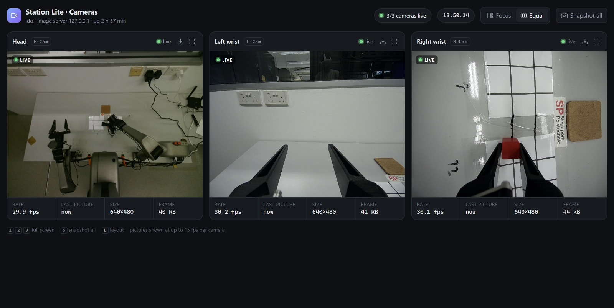
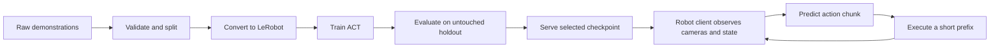
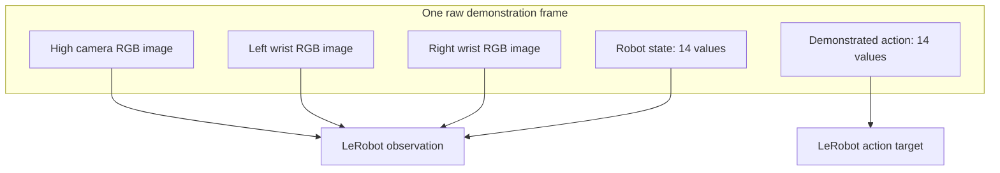
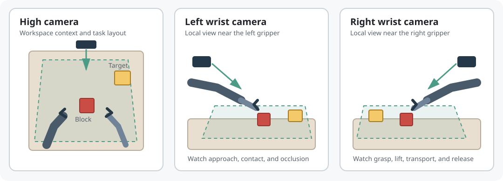
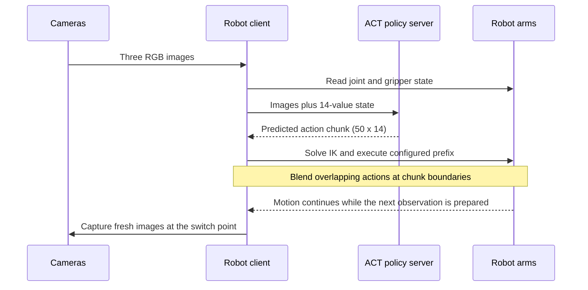

# ACT for Station Lite: student learning path

A small, reproducible ACT project for students working on a Station Lite pick-and-place task. It assumes the robot, cameras, CAN interfaces, network, and Python environments have already been installed and checked. The repository teaches the policy workflow: inspect demonstrations, convert data, train, evaluate on held-out episodes, serve the policy, and run a controlled robot test.

> This repository contains code and instructions only. Demonstrations, datasets, checkpoints, run logs, credentials, and machine-specific network settings belong in local storage and are ignored by Git.

## What you will learn

1. Understand the observation/action contract and verify a demonstration dataset.
2. Keep training, internal evaluation, and untouched holdout episodes separate.
3. Convert raw demonstrations to LeRobot format and train an ACT baseline.
4. Measure action prediction quality on held-out episodes, per episode and by prediction horizon.
5. Run inference through an HTTP policy server, then validate and deploy the policy on the prepared robot.

For a visual walkthrough of the camera inputs, 14-value state/action layout, and rolling action chunks, see [Reading the ACT inputs and outputs](docs/data-and-control-flow.md). It includes the three-camera observation and a sample pick-and-place video.



## The workflow at a glance



The offline path ends at evaluation. The live path adds a feedback loop: the client takes a fresh observation after executing part of each predicted chunk.

## Repository map

```text
configs/       Example experiment settings
data/          Local data goes here; never commit it
deployment/    Policy HTTP server and Station Lite client
evaluation/    Offline held-out-set evaluator
preprocess/    Raw demonstration to LeRobot converter
scripts/       Conversion and training entry points
```

## Before starting

The instructor or lab operator should provide:

- A prepared training computer with a working CUDA/PyTorch/LeRobot environment.
- A prepared robot computer with the vendor SDK, calibration files, camera service, and CAN interfaces working.
- The matching raw episode recordings and a manifest that states episode IDs and train/holdout membership.
- The matching robot and camera configuration. This repo does not install vendor SDKs or copy calibration files.

On the training computer, activate the existing environment and verify the essentials:

```bash
conda activate station_act
python - <<'PY'
import torch, lerobot
print("LeRobot:", lerobot.__file__)
print("CUDA available:", torch.cuda.is_available())
if not torch.cuda.is_available():
    raise SystemExit("CUDA is required for this training recipe")
PY
```

On the robot computer, activate the existing environment and verify the camera service and robot SDK using the lab's approved hardware checklist. Do not start a motion script until the workspace and robot are clear.

## 1. Organize and split demonstrations

Place raw recordings locally in the form below. Each episode directory contains `data.json` and its referenced RGB camera images.

```text
data/raw/
  train/
    zc0_touch_.../
    ...
  holdout/
    zc0_touch_.../
    ...
```

Freeze the episode split before training. Keep holdout episodes out of the training directory; do not pick checkpoints or tune parameters against holdout results. Record the exact episode IDs in a local manifest. Never commit recordings or manifests containing names, private paths, or identifying metadata.

Validate both splits before conversion:

```bash
python preprocess/validate_raw_dataset.py --root data/raw/train
python preprocess/validate_raw_dataset.py --root data/raw/holdout
```

The validator checks frame structure, finite joint/action values, referenced camera files, and image decoding. It reports the action gripper range as a quick sanity check; a human must still review whether each episode actually shows a successful task.

The reference recipe uses 35 training candidates, 10 untouched holdout episodes, 30 fps, and ACT with a 50-step action chunk. The training command reserves 13% of its training dataset for LeRobot's internal evaluation, so about 30 episodes contribute gradients. The external 10-episode holdout remains a separate final evaluation.

### What one demonstration frame contains

Each raw episode has a `data.json` sequence. A frame joins robot state and action with three camera image files. The converter maps these into one LeRobot row:



The policy receives the camera images and 14-value state, then predicts a chunk of 14-value actions. Both vectors are ordered as left arm (6 values) + left gripper (1) + right arm (6) + right gripper (1). Pose actions are end-effector XYZ + Euler rotation + gripper opening in metres. The gripper convention is `0 = closed`, `0.08 = open`.

The three views below are schematic. They show the intended roles of the cameras; the exact crop and visible workspace depend on camera placement.



Use all three views together: the high camera gives workspace context, while wrist cameras show the local approach near each gripper. During review, check that the block and target remain visible during approach, grasp, lift, transport, and release.

## 2. Convert demonstrations

Run on the training computer from the repository root:

```bash
conda activate station_act
python preprocess/convert_lumos_pose.py \
  --src data/raw/train \
  --out datasets/station_lite_train \
  --repo student/station_lite_train \
  --fps 30
```

Convert the holdout to a different dataset directory and repo ID:

```bash
python preprocess/convert_lumos_pose.py \
  --src data/raw/holdout \
  --out datasets/station_lite_holdout \
  --repo student/station_lite_holdout \
  --fps 30
```

Confirm the converted episode and frame counts against the manifest before training. The expected observation and action are each 14 values: left arm's 6 joints plus gripper, then right arm's 6 joints plus gripper. Images are `cam_high`, `cam_left_wrist`, and `cam_right_wrist`. Gripper action is opening distance in metres (`0` closed, approximately `0.08` open). Do not invert this value.

## 3. Train the baseline

```bash
conda activate station_act
DATASET_ROOT="$PWD/datasets/station_lite_train" \
REPO_ID='student/station_lite_train' \
OUTPUT_ROOT="$PWD/checkpoints" \
RUN_NAME='station_lite_act_baseline' \
STEPS=20000 BATCH_SIZE=4 \
bash scripts/train_act.sh
```

The baseline uses seed 42, ACT chunk size 50, batch size 4, 20,000 optimizer steps, and saves every 2,000 steps. The script refuses to overwrite an existing run directory. Review training loss and internal evaluation loss, but choose a candidate only after the external holdout evaluation.

## 4. Evaluate on the untouched holdout

```bash
conda activate station_act
python evaluation/evaluate_act_chunk_offline.py \
  --dataset-root datasets/station_lite_holdout \
  --repo-id student/station_lite_holdout \
  --raw-root data/raw/holdout \
  --checkpoint checkpoints/station_lite_act_baseline/checkpoints/020000/pretrained_model \
  --episodes 0 1 2 3 4 5 6 7 8 9 \
  --stride 10 --fps 30 \
  --output-dir outputs/holdout_baseline
```

Review both aggregate and per-episode results. Position MAE is mean absolute end-effector position error in metres. Also inspect orientation, gripper opening, prediction horizon, and the phase of the task. Offline action error is a diagnostic; it does not establish real-robot success.

## 5. Serve the policy and test on the prepared robot

Start the inference server on the GPU computer. Set the path to the selected checkpoint and use the server's reachable LAN address in the client command.

```bash
conda activate station_act
python deployment/station_act_http_server.py \
  --checkpoint "$PWD/checkpoints/station_lite_act_baseline/checkpoints/020000/pretrained_model" \
  --device cuda --host 0.0.0.0 --port 8008
```

Check `http://<GPU_HOST>:8008/health` from the robot computer; confirm it reports the intended checkpoint. Start the prepared camera service and check its expected port before running the client. First perform the lab's stationary observation and short-chunk checks. Only proceed to the full pick-and-place command when the workspace is clear and the operator can stop the robot.

Begin with an inference-only dry run. This reads camera images and checks that the policy server responds; it does not initialize or move the robot. The dry-run state is zero-filled, so use it only to check the image/server path.

```bash
conda activate lumosteleop
python deployment/station_lite_client.py \
  --server http://<GPU_HOST>:8008 --loops 1
```

After the operator verifies the robot's current pose and clears the return-home path, execute one short chunk:

```bash
python deployment/station_lite_client.py \
  --server http://<GPU_HOST>:8008 --execute \
  --loops 1 --speed 0.2 \
  --exec-steps 15 --switch-after 10 --blend-overlap 5 \
  --margin 0.02
```

This initializes both arms and returns them home when the client exits. Confirm the motion is safe before continuing to the longer test.

```bash
conda activate lumosteleop
python deployment/station_lite_client.py \
  --server http://<GPU_HOST>:8008 --execute \
  --loops 12 --speed 0.2 \
  --exec-steps 30 --switch-after 20 --blend-overlap 10 \
  --margin 0.02
```

Replace `<GPU_HOST>` with the current reachable address. The client uses the Station Lite vendor SDK installed on the robot computer, initializes both arms, and returns both arms home at the end. Review the client and obtain instructor approval before the first hardware run. Save each run log locally and label observed grasp and placement outcomes separately; the client log alone cannot certify a successful pick-and-place.



## Reproducibility checklist

- Record dataset episode IDs, split, frame counts, conversion FPS, and data version.
- Record code revision, environment versions, GPU, seed, training arguments, and checkpoint path.
- Evaluate candidate checkpoints on the same untouched holdout.
- For robot tests, keep initial robot pose, object location, camera view, lighting, and task layout fixed when comparing policies.
- Report grasp and placement success separately, alongside failures and safety stops.

## Local storage and GitHub

Keep `data/`, `datasets/`, `checkpoints/`, `outputs/`, `logs/`, and local settings out of Git. `.gitignore` excludes common data, model, log, and secret files. Before publishing, confirm that you have permission to redistribute each source file and choose a license appropriate to your organization and the vendor SDK. This starter does not include the SDK, robot calibration, recordings, or trained weights.

Before the first push, inspect the exact files that Git will include:

```bash
git init
git add .
git status --short
git diff --cached --stat
```

Check that no recordings, private manifest, checkpoint, log, credential, or local path appears. Add a suitable `LICENSE` only after code ownership and vendor redistribution rights have been confirmed. Then create an empty GitHub repository and connect it as `origin` before committing and pushing.

## Notes on this reference implementation

The converter, offline evaluator, inference server, and robot client are adapted from the lab's tested Station Lite workflow. The robot client depends on the locally installed `superbot`, `xr_teleoperate2`, `teleimager`, and StarTouch SDK packages. Environment setup and network/IP configuration are intentionally left to the lab operator.

The repository's documentation, comments, and command-line help are in English. The installed vendor SDK may still emit localized runtime messages.
