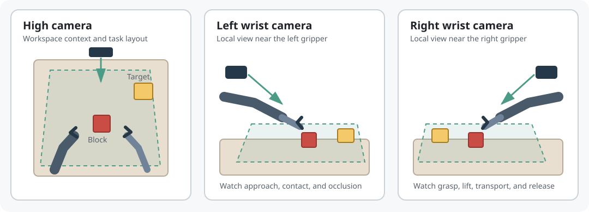
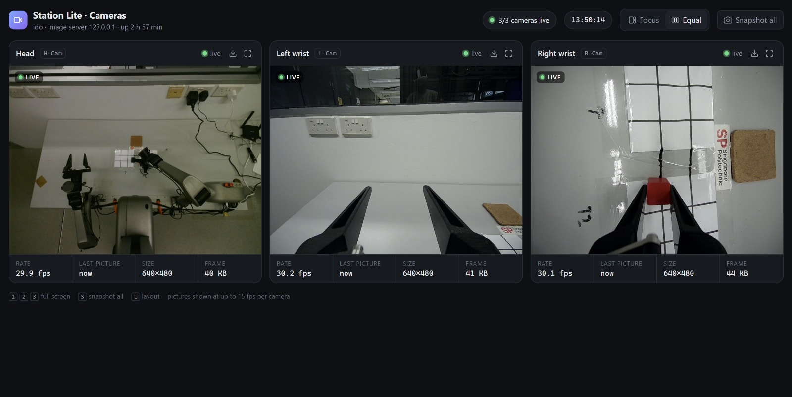
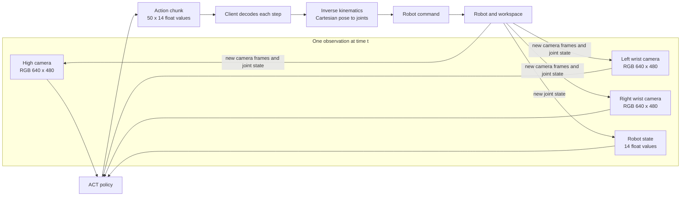

# Reading the ACT inputs and outputs

The three camera views answer different visual questions. The high camera shows the overall workspace and task layout. The wrist cameras show what each gripper sees near the object. ACT receives all three images together with a numeric robot state.



This schematic explains each view's role. The screenshot below shows the actual three-camera observation dashboard:



The figure is a screenshot of the live camera dashboard. The model input uses the three RGB camera frames, not the dashboard screenshot or its labels.

## Observation and action shapes



Each observation state is ordered as:

| Indices | Values | Units |
| --- | --- | --- |
| `0:6` | Left arm joint positions | radians |
| `6` | Left gripper opening | metres; `0` closed, about `0.08` open |
| `7:13` | Right arm joint positions | radians |
| `13` | Right gripper opening | metres; `0` closed, about `0.08` open |

Each action row has the same 14-value layout, but each arm's six values are Cartesian end-effector position and Euler rotation, followed by gripper opening:

```text
[left_x, left_y, left_z, left_rx, left_ry, left_rz, left_gripper,
 right_x, right_y, right_z, right_rx, right_ry, right_rz, right_gripper]
```

The policy predicts 50 future rows at a time. The robot client converts each arm's Cartesian target to joint positions with inverse kinematics (IK), then sends a trajectory chunk to the vendor SDK. It executes part of the chunk, captures a fresh observation, and asks ACT for an updated chunk. This is a receding-horizon loop: the policy repeatedly reacts to the latest camera and robot state.

## Watch a sample task

[Open the pick-and-place demonstration video](media/pick-and-place-demo.mp4).

While watching, follow the same phases in the camera views: approach the block, close the gripper, lift, move to the target, and release. Use the timestamps in the recording as visual context; the model's training labels come from the structured episode data and images, not from the video file.

## Questions for students

1. Which camera best shows where the block is relative to the target?
2. Which wrist view is most useful for confirming contact and gripper occlusion?
3. What changes between the observation state and the action row for the gripper?
4. Why should a new observation be captured before the next action chunk is requested?
