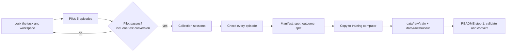

# Collecting demonstrations for ACT

This guide covers the stage before [step 1 of the README](../README.md#1-organize-and-split-demonstrations): recording teleoperated demonstrations on Station Lite, checking each episode, and organizing the episodes into the training and holdout folders the converter expects. It assumes the robot, cameras, VR headset and teleoperation software are already installed and working, as described in the vendor's Station Lite QuickStart guide.

> Recordings, manifests, calibration files and machine-specific settings stay on local storage. Nothing produced by this guide is committed to Git.



## 1. What each episode must contain

The converter (`preprocess/convert_lumos_pose.py`) and validator (`preprocess/validate_raw_dataset.py`) read one folder per episode. The teleoperation software writes it in this form:

```text
zc0_touch_<YYYYMMDD>_<HHMMSS>_<station>_<nnn>/
  data.json
  colors/
    000000_head_camera.jpg
    000000_left_wrist_camera.jpg
    000000_right_wrist_camera.jpg
    000001_head_camera.jpg
    ...
```

The date and time in the folder name are the robot's clock at the start of recording. Do not rename episode folders: the name is the episode ID used in the manifest, and the tools only pick up folders that start with `zc0_touch_`.

### Cameras

| Recorded name | LeRobot key | Role | Required format |
| --- | --- | --- | --- |
| `head_camera` | `observation.images.cam_high` | Whole workspace: block, target zone, both arms | RGB JPEG, 640 × 480 |
| `left_wrist_camera` | `observation.images.cam_left_wrist` | Close view of the left gripper | RGB JPEG, 640 × 480 |
| `right_wrist_camera` | `observation.images.cam_right_wrist` | Close view of the right gripper | RGB JPEG, 640 × 480 |

All three images must be present for every frame, even when only one arm does the task. The converter assumes 640 × 480. The `info.image` block in `data.json` may report a different size and frame rate; trust the image files, not that field.

### State and action fields in `data.json`

`data.json` holds a `data` list with one entry per frame. These are the fields the converter reads:

| Field in each frame | Values | Becomes |
| --- | --- | --- |
| `states.left_joint.qpos` | 6 joint angles, radians | state `0:6` |
| `states.left_gripper[0]` | measured gripper, raw units (the converter rescales it to metres) | state `6` |
| `states.right_joint.qpos` | 6 joint angles, radians | state `7:13` |
| `states.right_gripper[0]` | measured gripper, raw units | state `13` |
| `actions.left_arm.pose` | 7 values: XYZ (m), Euler rotation, gripper opening (m) | action `0:7` |
| `actions.right_arm.pose` | 7 values, same layout | action `7:14` |
| `colors.<camera>` | relative path of that frame's image | camera images |

The file also contains top-level blocks the checks below use:

- `summary.frame_count` and `summary.frame_span_duration` (seconds): used to measure the real frame rate.
- `idx` in each frame: the frame number. Frames carry no timestamps, so check that `idx` counts up by 1 with no gaps.
- `text.goal`: the task description that the converter stores as the LeRobot task string. It comes from the task entry selected when recording starts.

The action gripper value is the commanded opening in metres: `0` closed, about `0.08` open. Both arms are always recorded. In VR the arm that is not doing the task still copies the operator's other hand, so keep the idle hand still and away from the workspace.

## 2. Before the first session: lock the task

ACT imitates the demonstrations closely, so every condition that is not deliberately varied must stay the same for all episodes, including the holdout and the later robot test. Decide and record these before recording anything:

- **Object:** one block. Note its size, colour and material.
- **Target zone:** marked on the table (tape or a printed sheet). It does not move.
- **Start spots:** 5–6 marked training spots inside a safe area reachable by the task arm, for example P1–P5. Also mark 2–3 **test spots** (between or at the edge of the training spots, for example T1–T3). Test spots are never used for training or holdout recordings; they are only for the final robot test.
- **Robot start pose:** the home pose the arms return to. Every episode starts there.
- **Cameras and lighting:** do not touch camera mounts after this point. Use the same lighting for every session. Save one head-camera picture of the empty workspace and one with the block on each spot, so later sessions can be compared against them.
- **Task arm:** which arm does the task (or both).
- **Task ID:** the entry in the teleop task list (`~/lumosteleop/configs/tasks.yml` on the robot) that recordings are saved under. Ask the instructor which ID to use; do not assume an existing vendor task.
- **Success definition**, written down: the block is grasped, lifted clear of the table, placed inside the target zone, and is still there after the gripper opens.

## 3. Recording procedure

### Safety

- Two people: the operator in the headset, and a second person watching the arms with a hand near the emergency stop. Ctrl+C is not an emergency stop.
- Clear the table and the arms' homing path before starting. The arms have no obstacle detection.
- One program controls the arms at a time. Do not run test scripts while teleoperation is running.

### Start a session

Follow the vendor QuickStart guide for the details. In short, on the robot computer:

```bash
conda activate lumosteleop
cd ~/lumosteleop
./lumosteleop status                 # image-server and collect should not be running yet
./lumosteleop image-server           # terminal 1: start the cameras once per session
./lumosteleop collect <TASK_ID>      # terminal 2: teleoperation with recording
```

Running both inside `tmux` keeps them alive if the SSH connection drops. Connect the headset as described in the QuickStart, bring the arms home, and press **right A** so the arms follow.

Before the first real episode of every session:

1. **Gripper test:** press the trigger and confirm the real gripper closes and opens. A session where the trigger is not reaching the robot records episodes with no gripper command at all.
2. **Camera test:** record 5 seconds (right B, wave a hand in front of all three cameras, right B) and run the checks in section 4 on it. All three cameras must show movement. Then move this test episode out of the data folder (see "Discarding" below).

### Controls

| Button | Action |
| --- | --- |
| Right A | Start following; press again to stop and send both arms home |
| Right B | Start recording; press again to stop and save |
| Trigger | Close/open that hand's gripper |
| Left X or left A | Discard the current recording (the vendor guide and toolkit documents disagree; confirm on your setup during the pilot) |

Wait for `successfully saved to ...` in the `collect` terminal before starting the next recording. A save message does not prove the images are live; the camera checks in section 4 do.

### One episode

1. Place the block on the spot, in the same orientation every time. Arms at home.
2. Note the episode number and spot on paper (or straight into the manifest).
3. Right A (follow) → right B (start recording).
4. Approach → grasp → lift clear → move over the target zone → place → **open the gripper** → move the arm up and away.
5. Right B (stop and save) → right A (arms home).
6. Check the episode (section 4). If it fails, note it and record that spot again.

Guidelines:

- **Rotate through the spots** (P1 → P2 → … → P5, then again) rather than recording all repeats at one spot. Lighting, operator fatigue and small table shifts then spread evenly over the spots instead of being tied to one.
- **Keep a steady, normal pace** and the same order of moves every time. Avoid pauses longer than about 2 seconds; ACT learns pauses too.
- **One grasp per episode.** If the grasp slips, stop and discard the episode rather than re-grasping on camera.
- **Slow or unusual demonstrations** (for example recorded at half speed) go in their own session with their own session ID, so they can be included or left out as a group.

### Discarding

- During recording, use the discard button.
- After saving, **move** a bad episode out of the task folder instead of deleting or renaming it, and keep it for review:

  ```bash
  mkdir -p ~/lumosteleop/data_reject
  mv ~/lumosteleop/data/<YYYYMMDD>/task_<name>/<episode_folder> ~/lumosteleop/data_reject/
  ```

  A renamed folder inside the task folder is still copied and counted later.

### End of the session

Right A to send the arms home, have someone support the arms, then stop teleoperation and the image server as described in the QuickStart. Fill in the manifest (section 5) for the session before leaving.

### Pilot before bulk collection

Record 5 episodes, one per training spot, and take them through the whole offline pipeline before recording the full dataset:

- every check in section 4 passes;
- the block is visible in the head camera during approach, grasp, lift and place;
- one pilot episode converts with `convert_lumos_pose.py`, and the converted episode looks right in the LeRobot visualiser (three camera keys, 640 × 480, 14-value state and action, gripper between 0 and 0.08 m).

If anything is wrong, fix the setup and record a new pilot. Finding a problem after 40 episodes costs a full day.

## 4. Episode quality checks

Every episode gets three kinds of check: data checks with the repository validator, a camera and frame-rate check, and a human review. Run the first two right after each recording, or at least after each session, while the setup can still be fixed.

### 4.1 Data checks: the repository validator

```bash
python preprocess/validate_raw_dataset.py --root <folder with zc0_touch_* episodes>
```

It checks that every frame has the fields the converter reads, that all state and action values are finite, and that every referenced image exists and decodes. It prints the action gripper range for each episode. **A range of `0.080–0.080` means the gripper was never commanded to close**: the episode cannot show a grasp and must be discarded, and the trigger should be checked before recording more.

### 4.2 Camera and frame-rate check

The validator does not detect a camera that delivered the same picture over and over (a frozen stream), and it does not measure the frame rate. Run this on the same folder:

```bash
python - <folder with zc0_touch_* episodes> <<'PY'
import hashlib, json, statistics, sys
from pathlib import Path
from PIL import Image

CAMERAS = ("head_camera", "left_wrist_camera", "right_wrist_camera")
FROZEN_RUN = 15  # identical frames in a row (about 0.5 s) counts as frozen
root = Path(sys.argv[1])
rates = []
for ep in sorted(p for p in root.glob("zc0_touch_*") if p.is_dir()):
    payload = json.loads((ep / "data.json").read_text(encoding="utf-8"))
    frames = payload["data"]
    problems = []
    span = (payload.get("summary") or {}).get("frame_span_duration") or 0
    fps = (len(frames) - 1) / span if span else float("nan")
    if span:
        rates.append(fps)
    idx = [fr.get("idx") for fr in frames]
    if idx != list(range(idx[0], idx[0] + len(idx))):
        problems.append("frame idx has gaps or is out of order")
    for cam in CAMERAS:
        with Image.open(ep / frames[0]["colors"][cam]) as im:
            if im.size != (640, 480):
                problems.append(f"{cam} is {im.size[0]}x{im.size[1]}, not 640x480")
        run, longest, last = 1, 1, None
        for fr in frames:
            digest = hashlib.md5((ep / fr["colors"][cam]).read_bytes()).hexdigest()
            run = run + 1 if digest == last else 1
            longest, last = max(longest, run), digest
        if longest >= FROZEN_RUN:
            problems.append(f"{cam} frozen for {longest} frames")
    status = "OK" if not problems else "CHECK: " + "; ".join(problems)
    print(f"{ep.name}: {len(frames)} frames, {fps:.1f} fps -> {status}")
if rates:
    print(f"measured fps: median {statistics.median(rates):.1f}, range {min(rates):.1f}-{max(rates):.1f}")
PY
```

Any `CHECK` line means the episode is not used. A frozen camera usually means the image server has to be restarted; record the camera test again before continuing.

**Frame rate:** the recorded rate is not exactly 30 fps and varies between episodes (on our setup roughly 26–29 fps). The converter takes one `--fps` value for the whole dataset. Use the median that this check prints, rounded to an integer, for the conversion, and use the same value for every dataset and evaluation step of one experiment. Record the median and the range in the manifest notes.

### 4.3 Human review

The automatic checks cannot judge the task. For each episode, look at the head-camera frames (or a video made from them) and check:

| Check | Reject if |
| --- | --- |
| Success | The episode does not meet the written success definition, or ends with the block still in the gripper |
| Visibility | The block or target zone is hidden in the head camera for a long stretch, or a person, hand or extra object is in view |
| Start | The block was not on the noted spot, or the arms did not start at home |
| Motion | Re-grasp, collision with the table or block, jerky or shaking motion, long pause |
| Length | Much longer or shorter than the other episodes at normal pace (worth a second look, not an automatic reject) |

Failed and rejected episodes are kept in a separate folder and listed in the manifest with the reason. They never go into `train` or `holdout`.

## 5. Dataset organization

### On the robot

```text
~/lumosteleop/data/<YYYYMMDD>/task_<name>/zc0_touch_.../   # recordings, as written by collect
~/lumosteleop/data_reject/                                  # moved-out bad takes
```

### On the training computer

Copy each session's task folder into a staging area first, then move each episode into its split according to the manifest:

```bash
mkdir -p data/raw/incoming/<YYYYMMDD>
rsync -av <ROBOT_USER>@<ROBOT_HOST>:~/lumosteleop/data/<YYYYMMDD>/task_<name>/ data/raw/incoming/<YYYYMMDD>/
```

```text
data/raw/
  manifest.csv          # private; one row per recorded episode
  incoming/<YYYYMMDD>/  # copied sessions, not yet sorted
  train/                # episode folders directly inside, no subfolders
    zc0_touch_.../
  holdout/
    zc0_touch_.../
  reject/               # failed or rejected episodes, kept for the record
    zc0_touch_.../
```

Everything under `data/raw/` is excluded by `.gitignore`. Keep the episode folders directly inside `train/` and `holdout/`: the validator and converter look only one level down for `zc0_touch_*` folders. After sorting, `incoming/` should be empty; compare the number of folders in `train/` and `holdout/` with the manifest before converting.

### Manifest

Keep one CSV row per recorded episode, including failures. Suggested columns:

| Column | Example | Meaning |
| --- | --- | --- |
| `episode_id` | `zc0_touch_20261026_091902_<station>_001` | Folder name |
| `session_id` | `20261026_s1` | Date + session number; mark special sessions, e.g. `20261026_slow` |
| `task_id` | `11` | Task ID used for recording |
| `operator` | `op1` | Operator code, not a name |
| `task_arm` | `right` | Arm that did the task |
| `start_spot` | `P3` | Marked start spot |
| `outcome` | `success` / `failure` | Against the written success definition |
| `frame_count` | `312` | From the checks |
| `measured_fps` | `28.6` | From the check in 4.2 |
| `checks` | `pass` / `fail` | Validator + camera/fps check + human review |
| `split` | `train` / `holdout` / `reject` | Set once, before conversion |
| `notes` | `slight pause before release` | Anything unusual, and the reason for any reject |

The manifest is what makes the dataset reproducible: it records which episodes were used for training and which were held out. Keep it private (it is in `data/raw/`), and share it with the instructor through the approved channel.

## 6. Train, validation and test splits

The README recipe uses three groups of data. Only the first two are folders you create:

| Split | Where | Size in the recipe | Used for |
| --- | --- | --- | --- |
| Training | `data/raw/train` | 35 successful episodes | Gradient updates |
| Validation | Taken automatically from the training dataset | 13% of training (about 5 episodes) | LeRobot's internal evaluation loss during training (`--dataset.eval_split=0.13` in `scripts/train_act.sh`) |
| Test (holdout) | `data/raw/holdout` | 10 successful episodes | Final offline evaluation (README step 4) |

The robot test at the marked test spots (T1–T3) is a further test that uses no recorded episodes at all; report its results separately from the training spots.

Rules:

- **Split by episode, never by frame.** All frames of one episode belong to one split.
- **Decide the split before training and write it into the manifest.** Do not move episodes between `train` and `holdout` after seeing any results.
- **Spread the holdout across spots and sessions.** With 5 training spots and 10 holdout episodes, take 2 per spot, from more than one session, so the holdout covers the same conditions as the training data. A holdout recorded in one separate session also measures how much that session differed, not only how well the policy learned.
- **Choose the holdout episodes by a rule fixed in advance** (for example, the 3rd and 6th repeat at each spot), not by looking at which episodes look best or worst.
- **Only successful, checked episodes** go into `train` or `holdout`. Failures go to `reject`.
- **Never record training or holdout episodes at the test spots.** If a test-spot episode was recorded by mistake, put it in `reject`.
- **Keep the holdout untouched:** do not tune training settings against it repeatedly. If it has been used many times to make decisions, record a fresh holdout before reporting a final number.

To collect 35 training and 10 holdout episodes, plan for about 9–10 successful episodes per spot over 5 spots, plus a margin for rejects.

## 7. Checklist before conversion

- [ ] Task, workspace, start spots, test spots and success definition written down, with reference pictures
- [ ] Pilot of 5 episodes passed, including one test conversion
- [ ] Every episode passes the validator and the camera/frame-rate check
- [ ] Every episode reviewed by a person and marked success or failure
- [ ] Manifest complete: one row per episode, `split` filled in
- [ ] Holdout chosen by a fixed rule, spread across spots and sessions, never used for training
- [ ] Folder counts in `data/raw/train` and `data/raw/holdout` match the manifest
- [ ] Median measured fps recorded; the same value will be passed to `--fps`
- [ ] Nothing from `data/` is staged in Git (`git status --short` shows no recordings or manifest)

Then continue with [README step 1](../README.md#1-organize-and-split-demonstrations): validate both splits and convert them.
